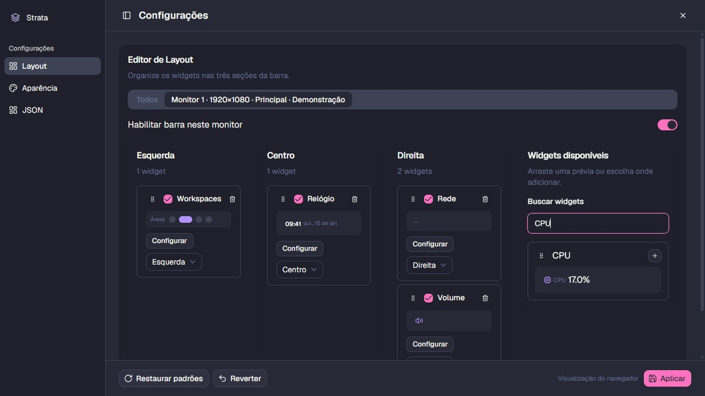

# Widget manager validation — 2026-10-22

Implementation follows [the approved plan](../plans/widget-manager-monitors.md)
for issue #13 / PR #17. No historical measurement files were overwritten.

Visual inspection used a separate, unsaved browser demonstration draft. The
catalog uses the same `WidgetPreview`; narrow-column management controls wrap
without changing preview internals.

## Automated gates

- `pnpm check`: formatting, ESLint, TypeScript and **342 passing tests in 53 files**.
- `pnpm build`: production frontend build passed.
- `cargo test --manifest-path src-tauri/Cargo.toml`: **203 passed, 21 ignored**.
- Targeted editor tests cover catalog availability, preview reuse, addition by
  column, pointer/keyboard dragging, cancellation, per-monitor removal/re-add,
  global mixed-field updates, bar activation, disconnect notices and discovery
  recovery. Existing widget, audio, JSON and subscription tests remain green.
- Native save/reopen tests cover membership, disabled bars, invalid/repeated
  references, validation of hidden widget overrides and stable-ID migration.

## Real Windows execution

[Native report](widget-manager-native-2026-10-22.json), produced by the opt-in
debug `--check-monitor-manager` harness using a unique temporary configuration.
The user's configuration was not used for the smoke test. The normal host was
restarted after validation.

Two physical displays were present: 3440×1440 at the primary origin and
1920×1080 above it with a negative Y coordinate.

- Opened the actual settings WebView and selected Monitor 1.
- Used its CPU Popover to set interval 4000 ms, compact format and tooltip off;
  Apply persisted only its overrides. The two live bars rendered different CPU
  label states, matching their projected configurations.
- Edited only the interval in Todos to 6000 ms. Native metrics diagnostics
  confirmed the live CPU subscription interval changed to 6000 ms; disk, GPU
  and memory stayed at 2000 ms. Other CPU settings remained independent.
- Disabled one monitor through the rendered Switch and Apply, then enabled all,
  disabled all and enabled all. Settings stayed available throughout.
- Direct Win32 monitor/work-area measurements confirmed reservation removal
  and exact restoration. Final visible bars retained tool-window/topmost styles,
  were ineligible for komorebi and had no `WS_EX_NOACTIVATE`.
- Foreground focus was unchanged across disabling/recreating bars. Saving and
  reopening the temporary configuration preserved the document.

The smoke check exposed a dynamic WebView construction deadlock on the UI thread
and activation caused by tao's show operation. Dynamic construction now runs on
serialized workers; owner-thread Win32 setup uses `SW_SHOWNOACTIVATE`, following
the existing floating overlay policy. Shutdown prevents late AppBar activation.

The local komorebi subscription reported an existing unavailable/subscribe error;
the report does not claim live komorebi workspace validation.

## Acceptance review and limits

Issue #13 interval/focus/style acceptance now has real Windows evidence. Its
monitor-widget part also has real Apply/render evidence. The combined criterion
for monitor widgets **and agent visibility** stays open until visibility is
checked with an active native agent session. Audio/JSON/editor criteria retain
their passing automated evidence.

Physical unplug/replug, changing the primary display and moving cables between
ports were not exercised. Migration/ordinal-change behavior is covered by native
tests, and monitor-change UI events by editor tests. Device-interface IDs cannot
guarantee identity when Windows assigns a new hardware/driver instance.

Independent Standards and Spec reviews found no remaining blocking defects.
The Standards review suggested an optional typed field-patch interface; this
does not affect native validation or the validated UI behavior.
