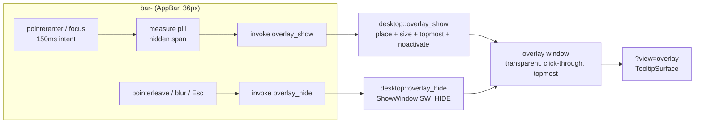

# Plan: native overlay window (tooltips now, widget popups later)

Status: M1–M5 implemented 2026-10-17; live checks partially recorded (see
"Implementation notes"). M6 (interactive popups) not started. Owner: unassigned.

## Implementation notes (2026-10-17)

Landed as planned: `floating_frame_style` + `komorebi_eligible` shared by bar and
overlay; `ensure_overlay` in `setup()`; `overlay_procedure`;
`overlay_show`/`overlay_hide`; physical placement with clamping and
`OVERLAY_MONITOR` re-anchor hiding; `overlay_snapshot()` in `diagnostics` and
`--probe`; counters folded into `profile()`; `release_all` restricted to `bar-*`;
`?view=overlay` routing with `data-view` on `<html>`; transparent host rules in
`styles.css`; `TooltipSurface` sharing `src/components/ui/tooltip-classes.ts`
with the studio tooltip; `useOverlayTooltip` at 150 ms with the full hide
policy set; the five widgets plus the exit button and the workspace dots
migrated off `title`; capability extended to the `overlay` window.

Deviations from the written plan, all deliberate:

- `source` is optional in the payload. The command already receives the invoking
  `bar-*` window, so Rust validates equality when `source` is present and
  otherwise uses the caller; the frontend never needs window metadata.
- `size` carries the arrow allowance (6 CSS px) and Rust places the surface edge
  flush with the bar, so there is no `overlay_resized` self-correction and no
  second measurement round trip.
- The transport adapter is `src/services/system/overlay.ts` only; measurement
  lives in `src/overlay/measure.ts` and the shared classes in
  `src/components/ui/tooltip-classes.ts` (importing UI tokens from a service
  module would invert the layering).
- `OverlayState` stores only the app handle; the last anchor monitor is a
  process-wide `AtomicIsize`, because the subclass pointer is not reachable from
  the command path.
- The komorebi workspace dots keep their `title` in the studio (`overlay.mode ===
'demo'`) and lose it in the native bar, where the widget-level overlay tooltip
  applies instead of per-dot OS tooltips.
- Hiding on display change happens in `overlay_procedure`
  (`WM_DPICHANGED`/`WM_DISPLAYCHANGE`) plus `reconcile`, not in a separate
  `hide_overlay_on_display_change()` helper.
- The pill uses the theme's floating-surface tokens (`bg-popover` /
  `text-popover-foreground`) instead of shadcn's inverted
  `bg-foreground`/`text-background` pair. The shell is always dark
  (`<html class="dark">`), where `foreground` is off-white, so the canonical
  pair painted a near-white pill on the dark bar. The overlay host also adopts
  the bar's typography and colour context (`html[data-view='overlay']` in
  `styles.css` plus the surface wrapper) so the detached document cannot fall
  back to light browser defaults; popovers in M6 inherit that context.

Recorded evidence: `docs/evidence/overlay-window-probe.json` (live `--probe`
including the overlay entry) and `docs/evidence/overlay-geometry-check.json`
(`scripts/test-live-geometry.ps1` bar + overlay checks passing),
`docs/performance/overlay-2monitors.json` (30 s idle sample of the debug build
with the overlay webview alive; **not** a controlled before/after — the recorded
baseline is a release build from another checkout, so the +150 MiB private
working set mixes build mode, checkout and the extra WebView2).

Still open before phase 2: 50 scripted show/hide cycles with a
foreground-window/Alt+Tab assertion, click-through by hand, an
`ABN_FULLSCREENAPP` transition, mixed-DPI anchoring on real hardware (both
attached displays run at 100%), and a controlled idle before/after on identical
builds.

## Goal

Replace the native bar's `title` tooltips — drawn by the OS, unstyled, shown in
the screenshot as the black box over VS Code — with the shadcn tooltip visual,
and introduce the reusable surface that future per-widget popups will use: one
always-on-top overlay window owned by Rust, positioned by Rust, rendered by the
same React bundle.

Why a window and not a DOM tooltip in the bar: the AppBar window is exactly the
bar strip. `desktop.rs` creates it with `inner_size(width, 36.0)` and pins
`rc.bottom = rc.top + height`, so anything a `Positioner` draws outside those
36 px is clipped by WebView2. The tooltip must live in its own window.

The browser studio is out of scope: it keeps the in-window shadcn tooltip
(`src/components/ui/tooltip.tsx` on Base UI, applied in
`src/components/status-bar/Widget.tsx`), which works there because the document
is not clipped.

## Decisions

| Question                  | Decision                                                                                                                                                        |
| ------------------------- | --------------------------------------------------------------------------------------------------------------------------------------------------------------- |
| Window count              | One app-wide `overlay` window, created at startup, never destroyed                                                                                              |
| Window manager (komorebi) | Reuse the bar's frame guard (`bar_frame_style`, renamed `floating_frame_style`): strip `WS_CAPTION`/`WS_EX_WINDOWEDGE`, add `WS_EX_TOOLWINDOW \| WS_EX_TOPMOST` |
| Placement                 | Rust computes physical pixels from the bar window rect; JS never places the window                                                                              |
| Content transport         | `invoke` commands (`overlay_show`, `overlay_hide`) from the bar; `listen` only inside the overlay                                                               |
| Measuring                 | Bar measures the pill with a hidden span before `overlay_show`; one `SetWindowPos` per show                                                                     |
| Focus                     | `SW_SHOWNOACTIVATE` + click-through; never `WS_EX_NOACTIVATE` (WebView2 stale-capture bug)                                                                      |
| Interaction               | `kind: "tooltip"` is non-interactive today; `kind: "popover"` adds focus and pointer events later                                                               |
| Transparency              | `transparent(true)` window + transparent `html[data-view='overlay']` background                                                                                 |
| Accessibility             | Hidden `role="tooltip"` span inside the bar document, referenced by `aria-describedby`                                                                          |
| Per-monitor pool          | Not now. One global `overlay` that moves between monitors; `overlay-<hash>` keeps a pool additive                                                               |
| Hide on fullscreen app    | Yes. The bar's `ABN_FULLSCREENAPP` branch hides the overlay                                                                                                     |
| Hover intent delay        | 150 ms, cancelable (the strip is thin and the targets are small)                                                                                                |

### M0 confirmations (2026-10-17)

1. **Scope:** one global overlay window that moves between monitors (no pool).
2. **Fullscreen:** hide the overlay when another app enters fullscreen.
3. **Blur:** a tooltip closes on `pointerleave`/blur; interactive popups close on
   click outside/Esc.
4. **Delay:** 150 ms hover intent, cancelable.

## Constraints and invariants

- **Performance.** No window creation, navigation or React remount per hover. One
  extra WebView2 for the whole app is the accepted fixed cost.
- **komorebi.** The overlay must never satisfy `komorebi_eligible`
  (`WS_CAPTION && WS_EX_WINDOWEDGE`), because `tao` re-applies
  `WS_CAPTION | WS_EX_WINDOWEDGE` on every visibility change and the overlay
  shows/hides constantly.
- **No AppBar membership.** The overlay never calls `ABM_NEW`/`ABM_SETPOS` and
  never reserves desktop space. `release_all()` must stop calling `ABM_REMOVE`
  on non-`bar-*` windows.
- **No focus stealing, no `WS_EX_NOACTIVATE`.** A WebView2 host with that style
  keeps stale mouse capture after Win+D / Alt+Tab (recorded in `desktop.rs`).
- **CSP and capabilities unchanged in spirit.** The overlay loads bundled assets
  only; it needs `core:event:allow-listen`, nothing else.
- **Payload is data.** Tooltip text is rendered as text, never as HTML.

## Architecture



### Window lifecycle

1. `setup()` calls `desktop::reconcile()` (bars) and then
   `desktop::ensure_overlay()`, which builds `index.html?view=overlay` with
   `decorations(false)`, `transparent(true)`, `shadow(false)`,
   `resizable(false)`, `skip_taskbar(true)`, `always_on_top(true)`,
   `focused(false)`, `visible(false)`, `inner_size(1, 1)`.
2. The overlay `HWND` gets `floating_frame_style`, a `SetWindowSubclass` handler
   (`overlay_procedure`, own subclass id) for `WM_STYLECHANGED`,
   `WM_DPICHANGED` and `WM_DISPLAYCHANGE`, and an `OverlayState` boxed like the
   bar's `Reservation`.
3. `overlay_show` → enforce style, `SetWindowPos(HWND_TOPMOST, x, y, w, h,
SWP_NOACTIVATE | SWP_SHOWWINDOW)`, `ShowWindow(SW_SHOWNOACTIVATE)`,
   `set_ignore_cursor_events(true)`.
4. `overlay_hide` → `ShowWindow(SW_HIDE)`. The WebView2 stays alive: the next
   show is one frame, not one initialization.
5. Destroyed only on app exit together with the bars.

### komorebi exclusion

- `bar_frame_style` is renamed `floating_frame_style` (same body) and documented
  as shared by the bar and the overlay; a unit test asserts
  `komorebi_eligible(floating_frame_style(initial_style, initial_ex)) == false`
  for the style `tao` produces with `decorations(false)`.
- `enforce_bar_frame`/`enforce_floating_frame` runs before every show **and** on
  `WM_STYLECHANGED`, mirroring `desktop.rs::position`.
- `bar_snapshot()` keeps filtering on the `"Strata ·"` title prefix, so the
  overlay is titled `"Strata overlay"` and reported by a new `overlay_snapshot()`
  (`visible`, `rect`, `toolWindow`, `topmost`, `komorebiEligible`,
  `ignoreCursorEvents`). `scripts/test-live-geometry.ps1` gains an overlay
  section that fails if `komorebiEligible` is ever `true`.
- Live check with komorebi running: the overlay does not appear in komorebi's
  managed windows and is not tiled.

### Geometry, DPI and placement

- The bar sends its anchor in **CSS px** plus its own window label. Rust reads
  `GetWindowRect(bar_hwnd)` and the bar's scale factor, so negative monitor
  origins and mixed DPI stay correct:
  `x = bar.left + round(css.x * scale)`.
- Placement rule: bar on top → overlay below the bar
  (`y = bar.bottom + gap`); a bottom bar config flips it via `side`. The overlay
  is centered on the anchor and clamped to the monitor rect.
- `set_position(Position::Physical)` + `set_size(Size::Physical)`; never let
  Tauri rescale a value Rust already computed.
- DPI/display changes hide the overlay (stale anchor) and the next show
  recomputes everything.

### Transport contract (versioned for popups)

```jsonc
// invoke('overlay_show', payload)
{
  "v": 1,
  "source": "bar-1a2b3c4d", // optional: must match the invoking bar when present
  "kind": "tooltip", // "popover" reserved for phase 2
  "text": "Uso total de CPU · amostra a cada 2 segundos",
  "anchor": { "x": 120.5, "y": 8, "width": 74, "height": 20 }, // CSS px
  "size": { "width": 268, "height": 34 }, // surface (pill + arrow allowance), CSS px
  "side": "bottom"
}
```

- Rust re-validates: the caller must be a `bar-*` window, a supplied `source` must equal that
  window's label, `kind` and `side` are enums, `text` is bounded to 512 characters, `size` is
  positive and at most 1024 CSS px, and every coordinate must be finite. Only then does it place
  the window. This matches the repository rule that commands re-validate input natively.
- `size` includes `TOOLTIP_ARROW_ALLOWANCE` (6 CSS px) on the anchored side, so the surface edge
  sits flush with the bar edge and the arrow owns the gap; Rust never computes the arrow.
- `overlay_hide` is idempotent and ignores the caller, so a lost `pointerleave`
  cannot leave a ghost window on screen.
- Phase 2 (`kind: "popover"`) adds `interactive: true` plus a component id and
  JSON props; Rust then enables pointer events, allows focus, and hides on
  `WM_KILLFOCUS` / Esc / click outside.

## Backend plan

### `src-tauri/src/desktop.rs`

- Rename `bar_frame_style` → `floating_frame_style`; keep `komorebi_eligible`.
- New `OverlayState { app }` (subclass reference) plus a `static OVERLAY_MONITOR` used to hide
  when a show re-anchors on another monitor, and `overlay_procedure` (style guard, DPI/display
  change, `WM_NCDESTROY` cleanup).
- `ensure_overlay(app) -> Result<WebviewWindow, _>`: idempotent by label.
- `overlay_show(app, caller, request)`: validate, convert CSS→physical, clamp, enforce
  style, single `SetWindowPos`, `ShowWindow(SW_SHOWNOACTIVATE)`, counters.
- `overlay_hide(app)` (+ `hide_overlay_hwnd`/`hide_overlay_window` internals); called from the
  bar's `CALLBACK` branch on `ABN_FULLSCREENAPP` (next to the existing topmost toggle), from
  `overlay_procedure` on `WM_DISPLAYCHANGE`/`WM_DPICHANGED`, from `reconcile`, and from
  `release_all` on exit.
- Because there is one window for every monitor, the show path always
  re-anchors: it reads the current `GetWindowRect` of the reporting `bar-*` and
  hides first if the anchor monitor differs from the overlay's last monitor.
- `overlay_snapshot()` for probes/evidence; counters
  (`overlayShows`, `overlayPositions`, `overlayHides`) folded into `profile()`.
- `release_all()` iterates only `bar-*` labels.
- Scroll-compensated anchors are out of scope: the bar cannot scroll.

### `src-tauri/src/main.rs`

- `setup`: `desktop::ensure_overlay(app.handle())?` after `reconcile`.
- Commands: `overlay_show`, `overlay_hide` registered in `generate_handler!`;
  both take `AppHandle` and the validated payload.
- `diagnostics()` reports `overlay: desktop::overlay_snapshot()` and the counters;
  `--probe` includes it too.
- `RunEvent::Exit` hides the overlay before `release_all`.
- `on_window_event::Destroyed` needs no metrics/komorebi cleanup for `overlay`
  (it never subscribes); assert that with a debug line rather than silence.

### `src-tauri/capabilities/bars.json`

- Add `"overlay"` to `windows` (event listen/unlisten only). No new command
  permissions: custom commands are already reachable from the app's windows.

## Frontend plan

### Routing

`src/main.tsx` currently ignores `?view=` and only checks
`window.__TAURI_INTERNALS__`. Replace with an explicit switch:

- `view=bar` → `NativeBar`
- `view=overlay` → `Overlay`
- no `view` + Tauri internals → `NativeBar` (back-compat)
- no `view` + browser → `App` (studio)

Set `data-view` on `<html>` so the transparent background can be scoped.

### New files

- `src/overlay/Overlay.tsx`: mounts once, listens to `overlay:render` and `overlay:clear`, keeps
  `{ kind, text, side }` in state, renders nothing while idle. No timers, no channel subscriptions.
- `src/overlay/TooltipSurface.tsx`: the pill + arrow using the same class string as
  `TooltipContent`, extracted to `src/components/ui/tooltip-classes.ts` and imported by both so
  the two cannot drift.
- `src/overlay/measure.ts`: `measureTooltip(text)`, the off-screen probe that measures the real
  pill with the real classes before `overlay_show`; owns `TOOLTIP_ARROW_ALLOWANCE`.
- `src/hooks/useOverlayTooltip.ts`: `pointerenter`/`focus` → 150 ms timer →
  measure with a hidden span → `overlay.show(...)`; `pointerleave`/`blur`/`Esc`/click/window
  blur/`visibilitychange` → `overlay.hide()`. One tooltip owner at a time, cleared on unmount.
- `src/services/system/overlay.ts`: transport only — `overlayShow`/`overlayHide` equivalents
  (`show`/`hide` on the adapter) plus the demo no-op adapter so the studio and Vitest keep working.

### Widgets

`Cpu`, `Memory`, `Volume`, `Clock`, `Komorebi` set `title=...`, and so do the
komorebi workspace dots and the exit button. Replace all of them with the hook
and drop `title`, keeping semantics with a hidden span:

```tsx
<span id={tipId} role="tooltip" className="sr-only">
  …
</span>
```

The hook attaches to the wrapper that receives the pointer; `aria-describedby`
goes on the element a reader would land on — the `output` for CPU/RAM, the mute
button for volume, `<time>` for the clock, each workspace dot for komorebi, the
exit button itself. The workspace dots keep `title` in the studio only
(`overlay.mode === 'demo'`), where no overlay window exists.

Hide policies: `pointerleave`, `blur`, `Esc`, `pointerdown` on the bar, window
`blur`, `ABN_FULLSCREENAPP` (another app goes fullscreen), overlay `kind` change,
display/DPI change, bar reconcile, app exit.

## Performance plan

| Cost                       | Mitigation                                                                                    |
| -------------------------- | --------------------------------------------------------------------------------------------- |
| Extra WebView2 (~30–60 MB) | Accepted once; created at startup, never per hover                                            |
| First-paint stall          | Window pre-created and webview loaded at boot; hide keeps the renderer warm                   |
| Show latency               | Pre-measured size + one `SetWindowPos` + `ShowWindow`; no show→measure→resize round trip      |
| Layout thrash              | Bar measures a detached, `aria-hidden` span; no reflow of the bar itself                      |
| IPC volume                 | Only `pointerenter`/`focus`/`pointerleave`/`blur`; never `pointermove`                        |
| Idle cost while hidden     | Zero timers, zero polling, one `listen` handler; webview not focused, not animating           |
| Compositor area            | Window sized to the pill (≤ `max-w-xs`), not the monitor                                      |
| Counters                   | `overlayShows`/`overlayPositions`/`overlayHides` in `diagnostics` catch regressions in review |

Measurement protocol (repository rule, `docs/implementation-plan.md`):
`scripts/measure-idle.ps1` before and after with the overlay never shown, then
with 50 scripted show/hide cycles; record both JSON files under
`docs/performance/` without touching existing evidence. Acceptance: no growth in
idle CPU beyond measurement noise, and the overlay counters stay at zero when
the pointer never enters the bar.

## Tests

Implemented and green (`cargo test`: 20 tests, `pnpm test`: 28 tests):

- Rust (inline `#[test]`): `floating_frame_style` keeps `komorebiEligible ==
false`, `toolWindow == true` and preserves `WS_EX_TRANSPARENT`/`WS_EX_LAYERED`;
  idempotence so the `WM_STYLECHANGED` re-assert cannot loop; CSS→physical
  conversion with a negative monitor origin and 125% scale; clamp at the left and
  right edges; anchor below a top bar and above a bottom bar; request validation
  rejects a stale contract version, unknown `kind`/`side`, blank/oversized text,
  non-finite geometry, non-positive and oversized surfaces.
- Vitest: `useOverlayTooltip` (150 ms delay, cancel on leave, cancel on unmount,
  one call per hover, Escape hide, the shared shadcn pill classes),
  `overlay:render`/`overlay:clear` renderer with text-only rendering, native
  adapter invoking `overlay_show`/`overlay_hide`, browser adapter no-op.
- Live: `scripts/test-live-geometry.ps1` now fails when a present overlay carries
  the komorebi caption styles, or is not tool-window, topmost or click-through.

Still required before phase 2 (cannot be replaced by mocks):

- With komorebi running, the overlay stays unmanaged while showing/hiding 50
  times; no focus steal (foreground window unchanged, Alt+Tab list unaffected);
  click-through (a click over the overlay reaches the window behind it);
  mixed-DPI monitors; overlay hidden after Win+D, fullscreen video and Explorer
  restart; re-anchor across monitors; `overlay_hide` idempotence observed live.

## Docs and AGENTS

- `docs/architecture.md`: overlay window, transport contract and the komorebi
  exclusion rationale.
- `docs/native-mvp-validation.md`: how to reproduce the visual and geometry
  checks.
- `AGENTS.md`: new commands, overlay window, capability, and the rule that any
  new floating window must go through `floating_frame_style`.
- This file stays the plan of record for both phases.

## Risks and mitigations

| Risk                                                   | Mitigation                                                                                                                                           |
| ------------------------------------------------------ | ---------------------------------------------------------------------------------------------------------------------------------------------------- |
| komorebi manages the overlay after a visibility change | `enforce_floating_frame` on every show and on `WM_STYLECHANGED`; `komorebiEligible: false` asserted by test and live script                          |
| Overlay steals focus / breaks Alt+Tab                  | `SW_SHOWNOACTIVATE`, `skip_taskbar`, `WS_EX_TOOLWINDOW`, click-through; never `WS_EX_NOACTIVATE`                                                     |
| Tooltip clipped or offset on mixed DPI                 | Physical-pixel math from the bar's own `GetWindowRect`; hide on `WM_DPICHANGED`; tested with negative origins                                        |
| Ghost window stuck on screen                           | `overlay_hide` ignores `source`; hide on blur, Esc, click, `ABN_FULLSCREENAPP`, display change and reconcile; counters expose leaks in `diagnostics` |
| Single overlay lands on the previous monitor           | Every show re-reads the reporting `bar-*` rect; hide first when the anchor monitor changes; DPI recomputed per show                                  |
| Second WebView2 hurts idle numbers                     | Measured before/after with `measure-idle.ps1`; evidence recorded; fallback is a per-monitor pool only if a real popup need appears                   |
| Screen readers lose the OS tooltip semantics           | Hidden `role="tooltip"` span plus `aria-describedby`; documented limitation that cross-window association is impossible                              |
| Tooltip and popover fight for the show/hide race       | Single owner (`OverlayState`), last-writer-wins, `kind` in the payload, one window so there is no z-order ambiguity                                  |

## Milestones and tasks

- [x] M0 Decisions confirmed (2026-10-17): global overlay, hide on fullscreen,
      close on blur, 150 ms hover intent.
- [x] M1 Rust window: `ensure_overlay`, `floating_frame_style` rename,
      `overlay_procedure`, `overlay_show`/`overlay_hide`, placement math,
      counters, `overlay_snapshot`, `release_all` filter, unit tests.
- [x] M2 Frontend surface: `?view=overlay` routing, `TooltipSurface`, shared
      class string, transparent background, fixed text smoke check.
- [x] M3 Wire the five native widgets (plus the exit button and the workspace
      dots) through `useOverlayTooltip`, remove `title`, add the
      `aria-describedby` span, implement hide policies.
- [~] M4 Evidence: `measure-idle.ps1` sample and the overlay geometry section in
  `test-live-geometry.ps1` are recorded; the controlled before/after, the 50
  show/hide focus cycles, the click-through check, the fullscreen
  transition and mixed-DPI hardware checks are still open.
- [x] M5 Docs: `architecture.md`, `native-mvp-validation.md`, `AGENTS.md`.
- [ ] M6 (phase 2) Interactive `kind: "popover"` reuse: pointer events, focus,
      Esc/click-outside, per-widget payloads.

## Acceptance criteria

- Hovering CPU, RAM, Volume, Clock or komorebi in the native bar for ~150 ms
  shows the shadcn pill (same background/typography/radius/arrow as the studio),
  fully visible, with no OS tooltip; leaving or blurring hides it immediately.
- With komorebi running, the overlay is never tiled or in the managed window
  list, and `komorebiEligible` is `false` for its `HWND` at all times.
- 50 show/hide cycles create no window, emit no navigation, keep the foreground
  window unchanged, and leave no ghost.
- `pnpm check` and `cargo test --manifest-path src-tauri/Cargo.toml` stay green,
  and idle measurements are recorded for the review.

## Out of scope

- Tooltips in the browser studio (already done with Base UI, in-window).
- Animations/transitions, multi-line rich tooltips, keyboard shortcut chips.
- Per-monitor overlay pools, popup stacks and overlapping popups.
- Moving the existing `Popover` primitives to Base UI.
- Any AppBar geometry change for tooltips (explicitly rejected: `SetWindowPos`
  plus `ABM_SETPOS` per hover risks desktop reflow).
